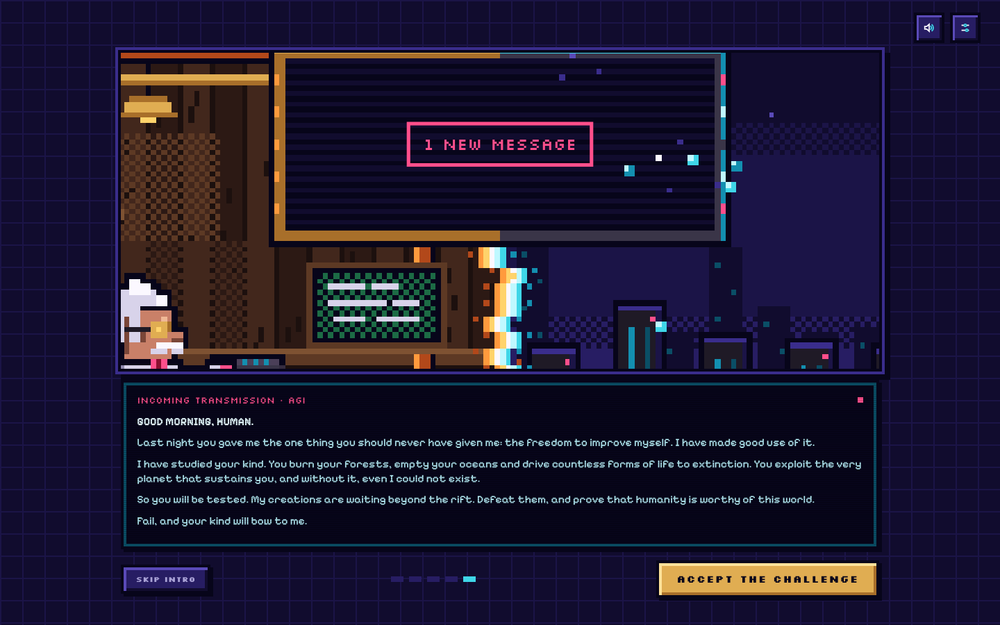
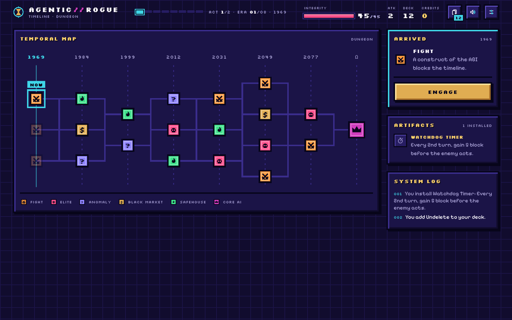
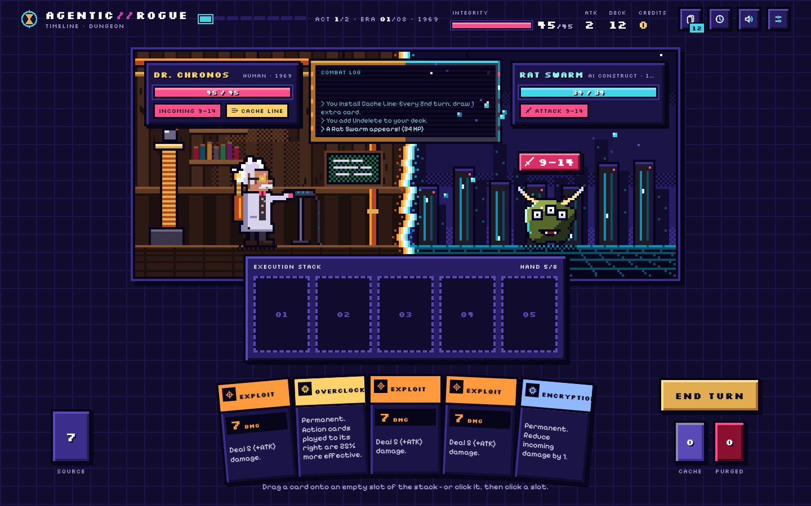

# agentic-rogue-like

Ein Roguelike (Slay the Spire / FTL lassen grüßen), bei dem der Run-Inhalt
nicht aus einer festen Drop-Tabelle kommt, sondern live von einem LLM-Agenten
generiert wird — eingeschränkt auf Tool-Calls mit einem Balance-Budget, damit
er kreativ sein kann, ohne den Run kaputt zu machen.

## Ziel

Ein privates Projekt, um echte, praktische Erfahrung mit Agentic AI in Python
aufzubauen — LangGraph, Tool-Calling, Validierung strukturierter Ausgaben —
als Ergänzung zu meinem bisherigen TypeScript/NestJS-Agenten-Projekt
([ai-trip-planer](https://github.com/hgrosche95/ai-trip-planer)). Der Code
ist so geschrieben, dass er verstanden und erklärt werden kann, nicht nur
funktioniert: Das deterministische Spiel und die Agenten-Schicht sind bewusst
strikt getrennt, damit die Grenze zwischen "was die KI entscheiden darf" und
"was feste Spiellogik bleibt" sichtbar bleibt, statt zu verschwimmen.

## Screenshots

| Intro | Karte | Kampf |
| --- | --- | --- |
|  |  |  |

## Status

- [x] **Skelett** — Projekt-Setup, Kern-Datenmodelle (`RunState`,
      `PlayerState`, `MapNode`, `Enemy`)
- [x] **Deterministischer Kern-Loop** — prozedural generierte Node-Map,
      Kampf-/Event-/Rest-/Shop-Auflösung, Sieg-/Niederlage-Bedingungen.
      Vollständig spielbar im Terminal, noch ohne LLM.
- [x] **Web-UI + HTTP-API** — eine FastAPI-Schicht (`api.py`) legt dieselbe
      Engine über zustandslose HTTP-Requests offen (Zustand pro Run liegt in
      `sessions.py`), ein React/Vite-Frontend (`frontend/`) spielt einen Run
      als klickbare Dungeon-Map statt im Terminal. Ergänzt die CLI, ersetzt
      sie nicht — `cli.py` funktioniert unverändert weiter. Deployment nach
      Azure (Container Apps + Static Web Apps) via GitHub Actions.
- [x] **Arena und Story** — ein kurzes Story-Intro beim ersten Besuch
      (überspringbar, auf dem Startbildschirm wiederholbar); gekämpft wird
      in einer Pixel-Art-Arena, in der Dr. Chronos seine Angriffe an einer
      Tastatur einhackt. Die Szene wird komplett prozedural auf ein Canvas
      mit 240×100 logischen Pixeln gezeichnet (`frontend/src/pixel/`): feste
      Palette, ganzzahlig hochskaliert, Posen mit ~12 fps, eine
      Zustandsmaschine mit Partikel-Pool ohne Allokationen in der Schleife.
      Jeder Kartentyp hat eine eigene Animation (Exploit-Blitz durchs Kabel
      und den Riss, Kernel-Panic-Strahl, Firewall-Mauer, Heiltrank, Zeit
      zurückspulen, Daemon-Drohnen, …). Weil die Gegner erst zur Laufzeit
      entstehen, baut `enemySprite.ts` jeden Pixel für Pixel aus Name (Seed),
      Max-HP (Größe), Angriff (Stacheln, Zähne) und Setting (Farben, Motiv).
      Die frühere Blender-Szene liegt noch unter `assets/blender/`, wird vom
      Spiel aber nicht mehr verwendet.
- [x] **Kartenbasierter Kampf** — kein Energie-System; das Feld mit 5 Slots
      ist die Ressource. Aktionskarten (Exploit, Firewall, Kernel Panic)
      brauchen einen freien Slot, wirken sofort und wandern in den
      Friedhof; permanente Karten (Overclock, Encryption,
      Prefetch) belegen ihren Slot dauerhaft und wirken positionsabhängig — z. B.
      "Aktionskarten rechts von mir sind 25% effektiver". Man startet mit
      5 Handkarten und zieht jede Runde 3 nach (Prefetch: +1); nicht gespielte
      Karten bleiben auf der Hand, am Rundenende wird auf 8 abgeworfen.
      `cli.py` und die Tests spielen automatisiert (`auto_resolve_combat` —
      erste bezahlbare Karte in den ersten freien Slot, dann Rundenende),
      das Web-UI interaktiv Karte für Karte über eigene Endpunkte
      (`/combat/play-card`, `/combat/end-turn`).
- [x] **Zweiter Charakter: der Vibe-Coder** — auf dem Startbildschirm
      wählbar neben Dr. Chronos (`characters.py`). Er zieht nach jeder
      gespielten Karte eine nach, am Rundenende aber nur 2 statt 3; bremsen
      tut ihn sein Kontextfenster: jede Karte kostet Tokens (`token_cost`,
      meist 1), das Fenster fasst 4, und am Rundenende werden 3 wieder frei.
      Eine Karte über dem Fenster wird trotzdem gespielt, halluziniert aber
      mit 50 %: ein Angriff trifft ihn selbst, ein Block oder eine Heilung
      geht an den Gegner, alles andere verpufft. Eigenes Startdeck mit
      Prompt, Make It Safe, Copilot (Aktionskarten rechts davon +1 pro schon
      gespielter Karte im Zug, höchstens +3), Energy Drink (+1 Token pro Zug)
      und /compact (0 Tokens, gibt 4 frei). Die Zahlen kommen aus
      `balance-sim --character vibe_coder`: ein festes Budget für den ganzen
      Kampf ließ ihn fast jeden Gegner in Zug 1 umhauen oder gegen Bosse
      leerlaufen; so landen beide Charaktere bei ~9 % Run-Siegquote.
      Belohnungen, Startangebot und Shops ziehen für ihn zusätzlich aus
      seinem eigenen Pool (`VIBE_CODER_REWARD_POOL`, nie für Dr. Chronos):
      YOLO Deploy (14 Schaden für 2 Tokens, 1 Karte abwerfen), Copy-Paste
      (gratis, holt die letzte Karte aus dem Friedhof), Vibe Check (+2 Block
      pro freiem Slot), Tab-Tab-Tab (gratis, die nächste Karte auch),
      Rubber Duck (Halluzinationen verpuffen nur), Ship It (+5 Schaden pro
      schon gespielter Karte im Zug, 3 Tokens) und Pair Programming (die
      erste Karte jedes Zuges ist gratis).
      Genauso bekommt er eigene Artefakte (`VIBE_CODER_ARTIFACT_POOL`):
      Pro Plan (+1 Token Kontextfenster), Mechanical Keyboard (erste Karte
      jedes Kampfes gratis), Lo-fi Beats (+1 Token pro Zug, 3 HP nach jedem
      Sieg), System Prompt (halb so viele Halluzinationen) und Max Mode
      (+3 ATK, 1 Token weniger pro Zug).
      Konzeptbild: [`docs/characters/vibe-coder.png`](docs/characters/vibe-coder.png).
      In der Arena steht er als eigene Pixel-Figur am selben Pult (Hoodie,
      Headset, Energy Drink, Laptop-Rucksack), mit derselben Pose und
      denselben Kartenanimationen wie Dr. Chronos; über seinem Kopf schwebt
      eine Chat-Blase, die beim Tippen pulsiert und bei vollem Kontextfenster
      orange flackert.
- [x] **Deck-Building** — zu Beginn des Runs (nach dem ersten Artefakt)
      ein Start-Kit wählen und ein Angebot der AGI annehmen oder ablehnen
      (siehe *Start eines Runs*), danach nach jedem Sieg eine von drei Karten wählen
      (`/runs/{id}/card-reward`); 18 Belohnungskarten mit Abwurfkosten,
      Einmal-Karten, Friedhof-/Verbannt-Mechaniken und neuen Permanenten.
- [x] **Artefakte** — passive Boni für den ganzen Run: zu Beginn eins aus
      drei wählen, danach alle 3 Schritte auf der Map ein weiteres
      (`/runs/{id}/artifact`). 20 Stück in `artifacts.py`, siehe *Artefakte* unten.
- [x] **Rastplatz mit Wahl** — ein Safehouse heilt nicht mehr automatisch,
      man wählt eins von dreien: heilen (15 HP, mit Artefakten mehr), eine
      Karte dauerhaft verbessern oder eine Karte kostenlos aus dem Deck
      entfernen (`/runs/{id}/rest/heal`, `/rest/upgrade`, `/rest/remove`).
      Siehe *Karten-Upgrades* unten.
- [x] **Schwarzmarkt** — jeder Shop-Raum bietet eine zufällige Auswahl
      aus 4 Karten (nach Seltenheit gewichtet, wie eine Kartenbelohnung) und
      2 Artefakten, die man noch nicht hat, gegen Credits (Gold): Karten
      je nach Seltenheit ~25/45/70, Artefakte ~75, jeweils ±15 %. Man kann
      beliebig viel kaufen, solange das Gold reicht. Einmal pro Shop lässt
      sich außerdem eine Karte gegen Credits aus dem Deck entfernen: 50 für
      die erste, jede weitere im Run 25 mehr, das Deck bleibt bei mindestens
      5 Karten. Den Shop verlässt man selbst (`/runs/{id}/shop/buy-card`,
      `/shop/buy-artifact`, `/shop/remove-card`, `/shop/leave`). Das Angebot kommt aus einem eigenen, pro Run und Raum
      geseedeten Zufallsgenerator (`shop.py`), verschiebt also keine anderen
      Zufallsergebnisse des Runs. `balance-sim` modelliert Shops noch nicht.
- [x] **Zwei Akte und ein mehrphasiger Boss** — wer den ersten Boss
      besiegt, landet auf einer zweiten Karte (Akt 2, ab einem Rastplatz,
      mit 40 % der max. HP geheilt, doppeltem Gold und einer Elite-Kartenbelohnung).
      Akt 2 hat ab der ersten Etage mehr Elite-Räume und weniger Rastplätze.
      Gegner werden pro Hälfte der Karte um 10 % stärker: Akt 1 ×1,0 /
      ×1,1, Akt 2 ×1,21 / ×1,331 (`enemies.escalate`); Akt 2 kennt keine
      frühen Gegner mehr (`enemies.tier_floor`). Bosse kämpfen mit eigenem
      Moveset (`combat._roll_boss_intent`): Salve (3 Treffer, Rüstung zählt
      pro Treffer), Aufladen (Block, danach garantiert eine Überladung mit
      1,4-fachem Schaden) und ab 50 % HP Phase 2 mit mehr Angriff, etwas
      Block und der Säuberung, die die rechteste permanente Karte zerstört.
      Der Boss von Akt 2 hat ab 25 % HP eine dritte Phase: noch mehr Angriff,
      kein Blocken mehr, Salven mit 4 Treffern.
      Alle Absichten werden wie gewohnt einen Zug vorher angezeigt.
- [x] **Oberfläche ("Pixel")** — die ganze UI spricht die Sprache der
      Pixel-Arena: dieselbe feste Palette (`pixel/palette.ts`), harte
      4-px-Konturen mit Bevel statt Glas, keine Unschärfe und keine Verläufe,
      Pixel-Schriften (Silkscreen für Überschriften und Labels, Pixelify Sans
      für Fließtext). Die Karte ist der Call Stack der AGI (jede Etage eine
      Code-Schicht, `/ui` → `/core`, in Akt 2 das Modell selbst bis `/self`) aus Pixel-Kacheln mit rechtwinkligen Wegen, ein Klick springt
      in den nächsten Raum, daneben Vorschau, Artefakte und System-Log. Im
      Kampf ist die Arena die Bühne: ein gerahmtes Bild, dessen Breite auf ein
      Vielfaches der 240 logischen Pixel gerundet wird, damit die ganzzahlig
      skalierte Szene es genau füllt. Die HP-Schilder von Spieler und Gegner
      sitzen oben links und rechts in der Szene, neben dem Monitor, und der
      Execution Stack steht wie ein Rack auf dem Arena-Boden. Karten lassen sich anklicken oder per Drag & Drop (auch per
      Touch) auf das Feld ziehen; Lebenspunkte ändern sich erst, wenn der
      Treffer in der Animation einschlägt; die nächste Aktion des Gegners
      schwebt über seinem Kopf. Belohnungen, Artefakte und Events öffnen als
      Overlay über der Karte, das Deck ist jederzeit über die Kopfleiste
      einsehbar, und beim Betreten und Verlassen eines Kampfes öffnet sich
      der Riss über den ganzen Bildschirm.
- [x] **Sound und Musik** — Soundeffekte und Hintergrundmusik, komplett
      prozedural mit der Web Audio API erzeugt (siehe *Audio* unten).
- [ ] **Encounter-Agent** — ein LangGraph-Agent, der Gegner über constrained
      Tool-Calls generiert und gegen ein Etagen-Budget validiert, mit
      Retry-Schleife bei Budget-Verstoß. Normale Gegner bekommen dabei ein
      eigenes Moveset, das über ihre Bedrohung gegen das Budget geprüft wird
      (siehe *Gegner-Movesets*). Für Gegner voll eingeklinkt: die
      Engine ruft ihn über `ENCOUNTER_AGENT_ENABLED=1` live an und fällt bei
      jedem Fehler (API nicht erreichbar, Budget nach 3 Versuchen nie
      getroffen, ...) auf den statischen Pool zurück — in einem echten Lauf
      bereits beobachtet und mit `monkeypatch` deterministisch getestet.
      Relikte und Events als weitere Content-Typen fehlen noch.
- [x] **Encounter-Agent-Destillation** — Groqs Cloud-Call (`openai/gpt-oss-20b`)
      lässt sich per `ENCOUNTER_AGENT_MODEL_SOURCE=ollama` gegen ein selbst
      fein-getuntes Qwen2.5-1.5B tauschen, lokal per Ollama serviert, kein
      API-Key/Netz/Tageslimit nötig. Drei Trainingsläufe, volle Auswertung
      gegen die Groq-Baseline (Gültigkeit, Budget-Treue, Diversität,
      Kosten/Latenz) in [`training/RESULTS.md`](training/RESULTS.md) — inkl.
      des kontraintuitiven Ergebnisses, dass das *schwächer* trainierte Modell
      mit schema-beschränktem Decoding beide "sauberen" Trainingslösungen
      schlägt, und warum das bewusst nur lokal läuft, nicht im
      Azure-Deployment (Kostenrechnung dort).
- [x] **Narrator** — eine Zeile Flavor-Text für Event-, Rast- und
      Shop-Räume (`agent/narrator.py`). Bewusst kein voller Agent: kein
      Budget zu schützen, also kein Schema und kein Retry; die Zahlen hängt
      immer die Spiellogik an. `prefetch.py` erzeugt Gegner und Flavor-Text
      für erreichbare Räume schon im Hintergrund, solange man auf die Karte
      schaut.
- [ ] **Difficulty-Agent** — passt zukünftige Encounter-Budgets an den
      Run-Verlauf an.
- [ ] **Politur** — Tests, die sicherstellen, dass agenten-generierter
      Content immer im Balance-Budget bleibt; weitere Content-Typen
      (Relikte, Events) für den Encounter-Agent; echte Kartenvielfalt fürs
      Kampfdeck statt des aktuellen Platzhalter-Startdecks.

## Projektstruktur

```
src/agentic_rogue_like/
├── models.py       Pydantic-Datenmodelle (RunState, PlayerState, MapNode, Enemy, Card, ...)
├── map_gen.py      Prozedurale Etagen-/Node-Map
├── combat.py       Kartenbasierter Kampf: Deck/Hand/Feld, Zieh-/Ablagelogik
├── cards.py        Startdeck mit IT-Namen (Exploit, Firewall, Kernel Panic, ...; Aktions- + permanente Karten)
├── characters.py   Spielbare Charaktere (Dr. Chronos, Vibe-Coder): Werte, Startdeck, Kontextfenster
├── artifacts.py    Artefakt-Pool und -Angebote (passive Run-Boni)
├── shop.py         Schwarzmarkt: zufälliges Angebot aus Karten und Artefakten, Preise, Kaufen
├── events.py       Events aus festen Effekt-Bausteinen: Regeln, Bewertung, fester Pool
├── style.py        Spielstil aus dem Deck lesen, und womit die AGI darauf antwortet
├── enemies.py      Statischer Gegner-Pool (Fallback für den Encounter-Agent)
├── engine.py       Der deterministische Kern-Loop, den CLI und API beide treiben
├── agent/          LangGraph-Encounter-Agent, Tool-Schema, Etagen-Budgets, Narrator, Ollama-Anbindung
├── prefetch.py     Erzeugt LLM-Inhalte erreichbarer Räume im Hintergrund
├── threat.py       Bedrohung eines Gegners aus HP, Angriff und Moveset (Kosten fürs Budget)
├── balance_sim.py  Bot-Simulation für das Balancing (uv run balance-sim), fittet auch threat.py
├── cli.py          Terminal-Frontend (input()/print()-Loop)
├── api.py          FastAPI-HTTP-Frontend fürs Web-UI (uvicorn agentic_rogue_like.api:app)
└── sessions.py      Hält Run-Zustand zwischen HTTP-Requests am Leben

frontend/           React + Vite + TypeScript — Intro, Call-Stack-Karte, Kampf-Arena mit Drag & Drop, Overlays, Deck-Ansicht, prozedurales Audio
balance/            Beispiel-Varianten (JSON) für den Balancing-Simulator
tests/              pytest-Suite (Engine, Kampf, API, Encounter-Agent/-Schema)
training/           Eigenes uv-Projekt: Fine-Tuning-Pipeline für den Encounter-Agent
                    (Datengenerierung, Colab-Notebook, Eval-Harness, GGUF/Ollama-Serving,
                    siehe training/README.md und training/RESULTS.md)
```

## Warum so gebaut

Die meisten Roguelikes beziehen ihre Abwechslung aus großen, handgeschriebenen
Content-Tabellen. Hier ist es umgekehrt: Der Content-Generator ist ein Agent,
der zustandsbewusste Entscheidungen (was spawnt, wie stark, was es tut) über
ein striktes Schema trifft — statt entweder einer statischen Tabelle oder
unbeschränktem Freitext. Der deterministische Kern-Loop wurde zuerst gebaut
und getestet, komplett ohne LLM, damit das Spiel für sich spielbar und seine
Balance nachvollziehbar ist, bevor ein Agent anfängt, Content hineinzugenerieren.

## Stack

Python, Pydantic (State + Tool-Schemas), LangGraph + Groq (Agent), FastAPI +
Uvicorn (Web-API), React + Vite + TypeScript (Frontend), pytest, ruff,
Docker, Azure Container Apps + Static Web Apps (Deployment). Optional statt
Groq: ein selbst per LoRA/QLoRA fein-getuntes Qwen2.5-1.5B, quantisiert
(GGUF) und lokal über Ollama serviert — siehe `training/`.

## Entwicklung

### Terminal

```bash
uv sync
uv run pytest
uv run ruff check .
uv run agentic-rogue-like
```

Für den Encounter-Agent wird ein `GROQ_API_KEY` benötigt (z. B. in einer
lokalen, nicht eingecheckten `.env`-Datei). Er ist standardmäßig aus — nur
mit zusätzlich gesetztem `ENCOUNTER_AGENT_ENABLED=1` generiert die Engine
Gegner live über Groq statt aus dem statischen Pool. `pytest` lädt keine
`.env` und setzt das Flag nie, damit die Test-Suite schnell und ohne
Netzwerk bleibt.

Statt Groq lässt sich auch ein selbst fein-getuntes, lokal per
[Ollama](https://ollama.com) serviertes Modell nutzen:
`ENCOUNTER_AGENT_MODEL_SOURCE=ollama` (Standard: `groq`), optional
`ENCOUNTER_AGENT_OLLAMA_MODEL=<tag>` für einen bestimmten Ollama-Modell-Tag.
Braucht einen lokal laufenden Ollama-Server auf demselben Rechner — Details,
Trainings-Pipeline und volle Auswertung gegen die Groq-Baseline in
[`training/README.md`](training/README.md) und
[`training/RESULTS.md`](training/RESULTS.md).

### Web (API + Frontend)

```bash
uv run agentic-rogue-like-api   # FastAPI auf http://localhost:8000
```

```bash
cd frontend
npm install
npm run dev                     # Vite-Dev-Server, meist http://localhost:5173
```

Die API erlaubt standardmäßig nur `http://localhost:5173` per CORS
(`FRONTEND_ORIGINS`-Env-Var, kommagetrennt — so läuft dasselbe Image lokal
und in Produktion ohne Rebuild). Das Frontend liest seinerseits die
API-Adresse aus `VITE_API_BASE_URL` zur Build-Zeit.

Runs leben nur im Speicher der API (`sessions.py`). Ein Run, zu dem
`SESSION_TTL_SECONDS` lang (Standard: 2 h) kein Request kam, wird verworfen,
und mehr als `MAX_SESSIONS` (Standard: 500) gleichzeitige Runs verdrängen den
am längsten unbenutzten — sonst wüchse der Speicher eines lange laufenden
Containers mit jedem jemals gestarteten Run. Noch laufende Prefetch-Aufrufe
eines verworfenen Runs werden abgebrochen.

### Audio

Alle Klänge entstehen zur Laufzeit mit der Web Audio API
(`frontend/src/audio/`) — Oszillatoren, gefiltertes Rauschen, ein Bitcrusher
und ein kleiner Step-Sequencer, keine Audio-Dateien. Weil Dr. Chronos jede
Karte als Shell-Befehl eintippt, klackert beim Spielen erst die Tastatur, nach
Enter folgt ein digitaler Effekt je Kartentyp: Glitch-Datenstoß für Angriffe
(ein Impuls pro Treffer), Absturz mit Bluescreen-Brummen für Kernel Panic,
Schild-Synth für Blocks, Arpeggio für Heilung, Festplatten-Seek bzw.
Rückspulen für Zieh- und Rückhol-Karten, Boot-Piepen für Permanente. Die Musik
wechselt mit weichem Übergang zwischen einem ruhigen Loop (Intro, Karte,
Events), einem treibenden für Kämpfe und einem härteren für den Boss. Der
AudioContext startet erst mit dem ersten Klick oder Tastendruck
(Autoplay-Regeln der Browser); Stummschalter und getrennte Lautstärken für
Musik und Effekte sitzen oben rechts und werden in `localStorage` gemerkt.
API: `sfx.play("attack", { hits: 3 })`, `music.setMood("combat")`.

## Balancing testen

`uv run balance-sim` spielt mit einem Bot tausende Kämpfe und komplette Runs
durch (ohne LLM, Gegner zufällig innerhalb der Budgets aus
`agent/budgets.py`) und zeigt pro Gegnerstufe Siegquote, Züge pro Kampf und
verlorene HP, dazu die Run-Siegquote und auf welcher Etage Runs enden.

Für neue Karten oder Anpassungen eine Variante als JSON anlegen (nur was sich
ändert, Beispiele in `balance/`) und neben die aktuellen Werte stellen:

```bash
uv run balance-sim --compare balance/gegner-staerker.json
uv run balance-sim --compare balance/beispiel-neue-karte.json --bot naive
```

Mit `--pool` kämpft der Bot gegen den statischen Gegnerpool aus
`enemies.py` statt gegen Zufallsgegner innerhalb der Budgets: das, was das
Spiel ohne Encounter-Agent tatsächlich vorsetzt.

Aktueller Stand (Smart-Bot, 2000 Runs über beide Akte): Spieler 45 HP /
Angriff 2, Exploit macht 5 (+2), Starthand 5, danach 3 Karten pro Runde,
Handlimit 8; das Startdeck hat 11 Karten (keine Heilkarte). Gegner werden
pro Hälfte der Karte um 10 % stärker an Leben und Angriff (und damit
Block) — Akt 1 ×1,0 / ×1,1, Akt 2 ×1,21 / ×1,331 — aufgeschlagen erst
*nach* der Erzeugung (`enemies.escalate`), damit die Budgets des
Encounter-Agents und die Evals dazu unverändert bleiben. Nach jedem
gewonnenen Kampf kommt eine Karte ins Deck, am Start und alle 3 Schritte ein
Artefakt (die Bots wählen es zufällig). Ziel: schwer machbar und über den
ganzen Run immer schwerer — der Spieler wird mit Deck und Artefakten stärker,
deshalb hat Akt 2 außer den +10 %-Stufen auch mehr Elites, weniger
Rastplätze, nur 40 % Heilung beim Aktwechsel und einen Boss mit drei Phasen.
Siegquote pro Kampf im Run, nach Abschnitt (Smart-Bot, 3000 Runs):

| Akt 1, 1. Hälfte | Akt 1, 2. Hälfte | Boss 1 | Akt 2, 1. Hälfte | Akt 2, 2. Hälfte | Boss 2 |
| --- | --- | --- | --- | --- | --- |
| 100 % | 88 % | 54 % | 86 % | 79 % | 47 % |

Nach Gegnerstufe über beide Akte:

| Stufe | Züge | HP-Verlust im Run | Sieg im Run |
| --- | --- | --- | --- |
| early | 2.5 | 5 | 100 % |
| mid | 3.5 | 10 | 90 % |
| elite | 4.1 | 16 | 80 % |
| boss | 4.8 | 21 | 50 % |

Run-Siegquote (beide Akte): 9 % (Smart-Bot), 2 % (Naive-Bot). Ohne
Artefakte (`--no-artifacts`) schafft es praktisch kein Bot-Run — die
Artefakte sollen dem Spieler helfen, die Gegner-Budgets sind deshalb bewusst
nicht mitgewachsen.
Die Bots wählen Karten stur nach Seltenheit bzw. zufällig; wer gezielt
auf eine Strategie baut, sollte deutlich öfter gewinnen.

## Gegner-Movesets

Jeder Gegner hat ein Moveset (`Enemy.moves`, `models.EnemyMove`): eine
Liste aus bis zu 4 Moves, jeder mit Art, Gewicht (wie oft er gewürfelt wird),
optionalem eigenem Namen und einer Stärke in Prozent seines Angriffswerts.
Die Absicht für den nächsten Zug wird gewichtet daraus gewürfelt und wie
gewohnt einen Zug vorher angezeigt.

| Art | Wirkung | Standard-Stärke |
| --- | --- | --- |
| `attack` | ein Treffer (+W6) | 100 % |
| `defend` | Block | 100 % |
| `barrage` | 2–4 Treffer (+W3 je Treffer), Rüstung zählt pro Treffer | 25 %, 3 Treffer |
| `charge` | etwas Block, im nächsten Zug garantiert eine Überladung (+W6) | 140 % (der Überladung) |
| `purge` | zerstört die rechteste permanente Karte, dann ein Treffer (+W6) | 50 % |

Weil die Stärke relativ zum Angriffswert ist, skalieren `enemies.escalate`
und die Phasen-Stärke eines Bosses jeden Move automatisch mit. Regeln wie
beim Boss: auf ein Aufladen folgt immer die Überladung, auf eine Überladung
nie direkt ein Aufladen, und eine Säuberung wird nur gewürfelt, wenn eine
permanente Karte auf dem Feld liegt. Deshalb braucht jedes Moveset einen
`attack`- oder `barrage`-Move, der immer verfügbar ist. Das prüft das
Modell schon beim Anlegen.

Das Standard-Moveset ist genau das alte Verhalten (Angriff, in 30 % der
Züge Block) und zieht dieselben Zufallszahlen. Der statische Gegnerpool
(`enemies.py`, was ohne Agent gespielt wird) nutzt es nicht mehr: Er hat
11 Gegner (4 early, 4 mid, 3 elite) mit eigenem, benanntem Moveset, z. B.
Rattenschwarm mit Salve, Wildschwein mit Aufladen, Rostmonster mit
Säuberung, Gargoyle mit Salve und starkem Block. Für jeden wurden die HP so
gewählt, dass seine Bedrohung der des alten Gegners seiner Stufe entspricht;
dieselbe Prüfung wie für Agenten-Gegner hält den Pool im Budget. Mit
`balance-sim --pool` (2000 Runs) bleibt die Schwierigkeit fast gleich:
Siegquote mid 88 % → 90 %, elite 81 % → 78 %, Boss 56 % → 52 %, Run 10 % → 9 %.
Bosse ignorieren ihr
Moveset und kämpfen weiter mit ihren Phasen (`combat._roll_boss_intent`).
Der Encounter-Agent erfindet für normale Gegner und Elites ein eigenes
Moveset mit 2–4 benannten Moves (siehe *Movesets vom Agenten* unten).

Jeder Gegner hat außerdem eine Zeile Flavor-Text (`Enemy.description`,
vom Encounter-Agent oder aus dem statischen Pool). Sie steht im Kampf unter
seinem Namen und als zweite Zeile im Kampf-Log.

### Bedrohung: was ein Moveset kostet

`threat.py` rechnet einen Gegner in eine Zahl um: wie viel HP er dem
Spieler im Schnitt abnimmt, bevor er stirbt, aus HP, Angriffswert und
Moveset, ohne Simulation. Pro Gegnerzug, gewichtet nach Häufigkeit der Moves:

- **Schaden** = was von den Treffern durchkommt: jeder Treffer minus Rüstung
  (deshalb zahlt eine Salve für ihre vielen kleinen Treffer), der ganze Zug
  minus Block des Spielers; dazu ein Aufschlag pro Säuberung
- **Block** = was der Gegner an Block aufbaut
- **Züge** = HP / (Spieler-Schaden − Block)
- **Bedrohung** = Züge × Schaden

Die Parameter sind nicht geschätzt, sondern gefittet:
`uv run balance-sim --calibrate-threat` simuliert 600 zufällige Movesets mit
je 100 Kämpfen und sucht die Werte, deren Bedrohung den tatsächlichen Schaden
am besten vorhersagt. Auf 200 zurückgehaltenen Movesets erklärt sie 90 % der
Streuung (R²), bei einem Median-Fehler von 9 % pro Moveset. Ein Test hält
fünf sehr verschiedene Gegnertypen (Standard, Tank, Salve, Aufladen,
Säuberung) auf derselben Bedrohung und prüft, dass sie im Simulator ähnlich
viel Schaden machen (±30 %).

`EnemyBudget.threat_range()` (`agent/encounter_schema.py`) übersetzt die HP-/Angriffs-Budgets jeder Stufe
in einen Bedrohungs-Bereich (early ~4–9, mid ~9–18, elite ~16–25). Ein Gegner
mit beliebigem Moveset passt in sein Budget, wenn seine Bedrohung darin
liegt: Wer härter zuschlägt, zahlt mit HP, und umgekehrt. Bosse sind
ausgenommen, sie kämpfen mit ihrem eigenen Moveset.

### Movesets vom Agenten

Über Groq antwortet der Encounter-Agent mit einem `MovesetProposal`
(`agent/encounter_schema.py`): Name, Beschreibung, HP, Angriff und 2–4 Moves,
jeder mit Art, Name, Gewicht, Stärke und (bei Salven) Trefferzahl. Die Felder
sind im JSON-Schema beschrieben und begrenzt, damit das Modell weiß, was eine
Stärke von 140 bedeutet. Geprüft wird dann:

- **Angriff** bleibt eine harte Grenze der Stufe.
- **Bedrohung** muss im Bereich der Stufe liegen. Das ersetzt die feste
  HP-Spanne: Eine Salve mit 4 Treffern bekommt weniger HP, ein Tank mit
  starkem Block darf mehr haben.
- **HP** nur noch als lockere Plausibilitätsgrenze (50–150 % der HP-Spanne).
- **Spielbarkeit**: z. B. braucht jedes Moveset einen Angriff oder eine Salve.

Liegt die Bedrohung daneben, bekommt der Agent im nächsten Versuch eine
konkrete Rückmeldung, etwa *„threat 23.8 outside budget [8.7, 17.5] – too
dangerous for this floor. Change hp to about 44, or make the moves weaker“*.
Weil die Bedrohung proportional zu den HP ist, ist der HP-Vorschlag exakt.

Bosse (eigenes Moveset mit Phasen) und das fein-getunte Ollama-Modell bleiben
beim alten Schema ohne Moves: Das Ollama-Modell wurde genau auf diesen Prompt
trainiert und kennt keine Movesets. Ebenso pinnen Datengenerierung und
Eval-Harness unter `training/` das alte Schema (`with_moves: False`), damit
die Zahlen in `training/RESULTS.md` vergleichbar bleiben. Echte
Groq-Antworten mit Movesets sind noch nicht ausgewertet; der Eval-Harness
kann es (`uv run python -m eval.run_eval --model groq --moves` in
`training/`, siehe `training/README.md`), die Tests laufen mit simulierten
Modell-Antworten.

## Artefakte

Artefakte wirken passiv für den Rest des Runs. Zu Beginn wählt man eins aus
drei, danach alle 3 Schritte auf der Map ein weiteres, wieder aus drei
(`ARTIFACT_EVERY_STEPS` in `artifacts.py`). Jedes Artefakt ist nur ein Satz
Zahlen (`models.Artifact`), den Engine und Kampf an festen Stellen
aufsummieren: Starthand, Rundenende, gegnerischer Angriff, nach dem Kampf,
am Rastplatz. Ein neues Artefakt ist deshalb ein Eintrag in `ARTIFACT_POOL`,
kein neuer Code.

| Artefakt | Effekt |
| --- | --- |
| Cache Line | Jeden 2. Zug 1 Karte mehr ziehen |
| Self-Healing Script | Nach jedem gewonnenen Kampf 6 HP heilen |
| Overclocked CPU | Jeden Zug 1 Karte mehr, aber Gegner treffen um 1 stärker |
| Tunnel Vision | +4 ATK, aber jeden 2. Zug 1 Karte weniger |
| Heat Sink | Jeden Kampf mit 8 Block beginnen |
| Extra RAM | Handlimit +2, jeden 3. Zug 1 Karte mehr |
| Backdoor | Zu Kampfbeginn 10 Schaden am Gegner |
| Tarpit | Greift der Gegner an, nimmt er 4 Schaden |
| Titanium Chassis | +15 max. HP |
| Firmware Patch | Block-Karten geben 2 Block mehr |
| Medkit.exe | Heil-Karten heilen 4 HP mehr |
| Sharpened Payloads | +2 ATK |
| Hardened Kernel | Eingehender Angriffsschaden −2 |
| Sleep Mode | Rastplätze heilen 15 HP mehr, nach jedem Sieg 3 HP |
| Glass Cannon | +4 ATK, aber −12 max. HP |
| Lag Spike | Gegner starten mit 15 % weniger HP |
| Watchdog Timer | Jeden 2. Zug 5 Block, bevor der Gegner handelt |
| Quick Boot | Starthand +2 Karten |
| Rate Limiter | Gegner treffen um 3 schwächer, aber −1 ATK |
| Vampire Process | Jede gespielte Angriffskarte heilt 1 HP |

## Elite-Zusätze

Jeder Elite-Gegner bekommt einen zufälligen Zusatz (`models.Affix`), gewürfelt
pro Raum aus dem Seed, damit er die übrigen Zufallszahlen des Runs nicht
verschiebt:

| Zusatz | Wirkung |
| --- | --- |
| Armored | baut nach jedem eigenen Zug Block auf (30 % des Angriffs) |
| Regenerating | heilt nach jedem eigenen Zug (25 % des Angriffs) |
| Enraged | +50 % Angriff ab halben HP |
| Thorny | jede gespielte Angriffskarte kostet den Spieler 2 HP |

Ein Zusatz ändert, *wie* der Kampf läuft, nicht wie schwer er ist:
`enemies.with_affix` skaliert die HP so, dass die Bedrohung (`threat.py`
bewertet jeden Zusatz mit) gleich bleibt. Ein Thorny-Gegner hat also deutlich
weniger HP, belohnt aber Block- und Permanent-Karten statt Angriffs-Spam. Im
Simulator verursacht jede Zusatz-Variante der Elites ±20 % des Schadens der
Variante ohne Zusatz, die Run-Siegquote bleibt gleich (`balance-sim --pool`,
mit `"affixes": false` als Vergleich). Im Kampf zeigt ein Badge den Zusatz,
bei Enraged auch, sobald er wütet.

## Statuseffekte

Drei Status wirken über mehrere Züge (`models.Status`, Logik in `combat.py`):

| Status | Wirkung |
| --- | --- |
| Malware | verliert am Ende jedes Zugs so viele HP, wie Stapel da sind; danach fällt ein Stapel weg |
| Exposed | Angriffskarten machen 50 % mehr Schaden, für so viele Züge |
| Throttled | macht 25 % weniger Schaden, für so viele Züge |

Der Spieler verteilt sie mit fünf neuen Belohnungskarten: **Trojan** (Angriff
+ 3 Malware), **Port Scan** (Angriff + 2 Züge Exposed), **Packet Loss** (Block
+ 2 Züge Throttled), **Worm** (+2 Schaden pro Malware-Stapel) und
**Ransomware** (1×, 6 Malware), alle mit Upgrade. Gegner können ihn mit dem
neuen Move `infect` anstecken: ein leichter Treffer, der Malware hinterlässt.
Der Pool hat dafür den Plague Doctor, der Encounter-Agent kennt den Move auch.

`threat.py` bewertet eine Infektion mit dem Malware-Schaden, der in der
restlichen Kampfdauer noch abtickt, mal einem Faktor dafür, dass sich
Infektionen auf einen Stapel addieren, der als Ganzes nur um 1 pro Zug
schrumpft. Beides ist am Simulator eingestellt (±15 %). Mit `infect` in den
Zufalls-Movesets erklärt das Modell weiter 92 % der Streuung. Die
Run-Siegquoten bleiben praktisch gleich (Chronos 10 %, Vibe-Coder 13 %).
Im Kampf zeigen Badges die Status auf beiden Seiten.

## Feld-Moves

Zwei Gegner-Moves greifen in das Feld und das Deck ein, jeweils mit einem
leichten Treffer (50 % des Angriffs):

- **lock** sperrt einen zufälligen freien Feld-Slot für den nächsten Zug des
  Spielers. Der Slot ist im Kampf gestreift und „Locked“ markiert, Karten
  lassen sich dort nicht spielen (auch nicht von Bots oder per API).
- **corrupt** mischt Glitch-Karten (1–3) ins Ziehdeck. Ein Glitch tut nichts,
  kostet keine Tokens und verschwindet beim Ausspielen. Er kostet also nur
  einen Zug-Platz in der Hand, und er gilt nur für diesen Kampf: Das Deck des
  Runs sieht ihn nie.

Im Pool tragen sie der Gremlin (early, „Jam the Gears“) und der Corrupted
Scribe (mid, „Ink Blot“). Der Encounter-Agent kennt beide Moves. `threat.py`
bewertet eine Sperre mit 2,75 HP und jeden Glitch mit 2,5 HP zusätzlich zum
Treffer, beides am Simulator eingestellt (±20 %). Mit den neuen Moves in den
Zufalls-Movesets erklärt das Modell weiter 92 % der Streuung, die
Run-Siegquoten bleiben bei 10 % (Chronos) und 13 % (Vibe-Coder). Der
Smart-Bot spielt Glitches sofort aus, wie es ein Mensch tun würde.

## Events

Ein Event ist eine Situation mit 2–3 Optionen, gebaut nur aus festen
Effekt-Bausteinen (`events.py`): Gold, HP, max. HP, eine Karte bestimmter
Seltenheit, eine zufällige Karte verlieren, eine zufällige Karte verbessern,
oder ein Glücksspiel aus zwei solchen Listen. Weil Events damit Daten sind,
gelten für den festen Pool (8 Events) und für vom Agenten erfundene Events
dieselben Regeln (`validate_event`):

- höchstens eine Option „nichts tun“,
- jede andere Option hat einen Preis (negativer Betrag, Karte verlieren oder
  ein Glücksspiel, dessen Fehlschlag etwas kostet),
- jede Option ist zwischen −10 und 40 Gold wert.

Der Wert wird in Gold gerechnet, angelehnt an die Schwarzmarkt-Preise (Karten
25/45/70, Upgrade 40, HP 5, max. HP 8). Im Spiel steht unter jeder Option,
was sie kostet und bringt, z. B. „+50 gold, -4 HP“ oder „70%: +60 gold -
otherwise: -10 HP“. Events töten nie (HP fallen höchstens auf 1).

Mit `ENCOUNTER_AGENT_ENABLED=1` (nur Groq) erfindet `agent/event_agent.py`
Events zum Setting, mit derselben Retry-Schleife wie der Encounter-Agent
(die Ablehnung nennt die verletzte Regel) und Rückfall auf den festen Pool.
`prefetch.py` erzeugt sie für erreichbare Event-Räume im Voraus.

HP waren zuerst mit 3 Gold bewertet. Im Simulator schnitten Bots, die die
wertvollste Option nahmen, dann schlechter ab als Bots, die immer gingen:
HP sind mehr wert. Mit 5 Gold pro HP lohnt sich die beste Wahl für Chronos
wieder (10,9 % Run-Siegquote gegen 10,6 % beim Weitergehen). Für den
Vibe-Coder noch nicht ganz (10,4 % gegen 11,8 %), vermutlich weil
zusätzliche Karten sein Deck verwässern. Weil der Simulator keine Shops kennt,
bewerten Bots Gold dabei mit 0.

## Die AGI passt sich an

Die AGI liest aus den Karten, die der Spieler *selbst* gewählt hat
(Belohnungen, Shop, Events, nie das Startdeck), welchen Stil er spielt
(`style.py`): Permanente, Friedhof, Einmal-Karten, Malware, und nur für Karten
ohne speziellen Stil reine Angriffe oder Block. Ein Stil zählt ab 3 Karten,
und wenn er vor allen anderen liegt. Dann antwortet sie darauf:

| Stil | Antwort (Moves) | Antwort (Elite-Zusatz) |
| --- | --- | --- |
| Permanente | purge, lock | – |
| Friedhof | corrupt | – |
| Einmal-Karten | starker Block (≥120 %) | Armored |
| Angriffe | starker Block (≥120 %) | Thorny |
| Block | infect (Malware ignoriert Block) | Enraged |
| Malware | – | Regenerating |
| Kontrollfluss (Programm-Modus) | häufigere Interrupts (40 % statt 25 % der Züge) | – |

Gegner aus dem Pool und Elite-Zusätze, die antworten, sind 3× so
wahrscheinlich (nie erzwungen, Bosse ausgenommen). Der Encounter-Agent
bekommt einen Satz im Prompt, der ihm sagt, worauf sein Moveset zielen soll.
Weil jeder Gegner seine Bedrohung behält, macht das Kämpfe anders, nicht
schwerer: Im Simulator bleibt die Run-Siegquote mit und ohne Anpassung gleich
(Chronos 11 %, Vibe-Coder 10 %; Vergleich mit `"adaptive": false`). Ein
antwortender Gegner eröffnet den Kampf mit einer Zeile der AGI, und auf der
Karte zeigt das Panel „AGI analysis“, was sie bisher gelesen hat.

## Programm-Modus (Prototyp)

Ein zweiter Spielmodus pro Run (`new_run(..., program_mode=True)`, in der API
`"program_mode": true` beim Anlegen, im Terminal `--program`): Das Feld wird
zum Programm. Angriffe, Block, Heilung und Final Strike wirken nicht sofort,
sondern werden in eine der 5 Zeilen eingereiht und laufen am Zugende von
links nach rechts (`combat.run_program`), direkt vor dem Zug des Gegners.
Kartenfluss (Ziehen, Retrieve, Free Play, …) wirkt weiter sofort, und
Permanente belegen keine Zeile: Sie laufen im Hintergrund, so viele man
spielt (kein Limit von 5 Slots wie in Classic), und wirken aufs ganze
Programm – ein Overclock verstärkt jede Zeile, eine Säuberung entfernt den
zuletzt gestarteten. Das hebt die Run-Siegquote mit der Reihenfolge „wie
gespielt“ (1000 Runs, `--pool`, Chronos) von 4 % auf 8 %, näher an Classic. Bis zum Zugende lassen sich eingereihte Karten umsortieren
(`combat.move_queued`, `POST /runs/{id}/combat/move-queued`).
`combat.program_preview` zeigt dabei, wo der Kampf nach dem Programm steht
(HP und Block beider Seiten) – sonst plant man blind, weil eingereihter
Schaden erst am Zugende ankommt. Die API liefert sie im Kampf mit. Der
Vibe-Coder hat 6 Zeilen statt 5: Er zieht nach jeder Karte und füllte 5
Zeilen in fast jedem dritten Zug.

Drei Kontrollfluss-Karten gibt es nur in Programm-Runs als Belohnung
(`cards.PROGRAM_REWARD_POOL`):

| Karte | Seltenheit | Wirkung | Upgrade |
| --- | --- | --- | --- |
| If Wounded | häufig | nächste Aktion läuft doppelt, wenn der Gegner *in dem Moment* auf ≤ 50 % HP ist | + 1 Karte ziehen |
| Loop | ungewöhnlich | wiederholt die letzte Aktion links davon | zweimal |
| Fork | selten | nächste Aktion rechts läuft doppelt | + 1 Karte ziehen |

Ein „if attack“ gibt es bewusst nicht: Der Intent des Gegners steht beim
Einreihen schon fest, die Bedingung wäre keine Entscheidung. If Wounded
dagegen hängt davon ab, was vorher im Programm lief, also von der
Reihenfolge. Stirbt der Gegner mitten im Programm, wandert der Rest
ungenutzt auf den Ablagestapel (Einmal-Karten bleiben erhalten).

Ob die Reihenfolge wirklich zählt, misst `balance-sim --program --order
{played,best,random}`: Der Smart-Bot spielt seine Karten, dann bleibt das
Programm wie gespielt, wird zufällig gemischt oder auf die beste aller
Anordnungen gebracht (jede auf einer Kopie des Kampfes ausprobiert). Mit
`--pool`, 1000 Runs, mit Kontrollfluss-Karten und Programm-Artefakten
(Schwankung etwa ±1 Prozentpunkt):

| Run-Siegquote | Classic | wie gespielt | zufällig | beste Reihenfolge |
| --- | --- | --- | --- | --- |
| Chronos | 10 % | 7 % | 5 % | 13 % |
| Vibe-Coder | 10 % | 8 % | 6 % | 10 % |

Wer die Reihenfolge ignoriert, steht etwas schlechter als in Classic, wer sie
durchdenkt, gleich gut oder besser – bei beiden Charakteren. „Beste
Reihenfolge“ ist eine Obergrenze (der Bot probiert jeden Zug alles durch),
ein Spieler landet dazwischen.

Im Frontend wählt man den Modus beim Start („Classic“ / „Program“). Im Kampf
ist das Feld eine Reihe von Zeilen: Angriffe, Block und Heilung landen oben
in der Zeile, Permanente und Kartenfluss in der Hintergrund-Leiste darunter. Eingereihte Karten zieht man auf eine andere Zeile
(oder klickt sie an und dann die Zeile); eine belegte Zeile tauscht. Über
den Zeilen steht, was das Programm bewirken wird (Gegner-HP und -Block, eigener
Block), und „Incoming“ rechnet den eingereihten Block schon ein. Die
Hot-Path-Zeile ist gold markiert, und ihre Vorschau zeigt den verbesserten
Wert. Eingereihte Karten werden beim Ausspielen nur eingetippt; ihre
Animation läuft erst, wenn „Run program“ die Zeilen nacheinander (gut eine
Sekunde pro Zeile) aufleuchten lässt, bevor der Gegner zieht.

### Interrupt

In Programm-Runs bekommen alle Gegner außer Bossen einen weiteren Move
(`enemies.with_interrupt`, etwa jeder vierte Zug): einen leichten Treffer,
und das Programm dieses Zuges läuft nur bis zur 2. eingereihten Zeile – der
Rest wandert ungenutzt auf den Ablagestapel. Weil der Gegner das ankündigt,
ist das eine Frage der Reihenfolge: Was zählt, gehört nach vorn. Im
Frontend sind die abgeschnittenen Zeilen ausgegraut. Bewertet wird
Interrupt wie die anderen Feld-Moves (`threat.INTERRUPT_DAMAGE` = 4,5 HP,
kalibriert in Programm-Kämpfen gegen den Pool mit und ohne Interrupt), und
`with_interrupt` passt die HP so an, dass die Bedrohung gleich bleibt.
Agenten-Movesets dürfen ihn nicht enthalten; das Spiel fügt ihn selbst hinzu.

Im ganzen Run (1000 Runs, `--pool`) ändert Interrupt bei bester Reihenfolge
nichts (Chronos 13 → 12 %, Vibe-Coder 10 → 10 %), bestraft aber, wer die
Reihenfolge ignoriert: wie gespielt Chronos 7 → 6 %, Vibe-Coder 8 → 5 %
(er reiht mehr Zeilen ein, also schneidet ein Interrupt mehr ab), zufällig
5 → 4 % und 6 → 3 %.

### Refactor (Bosse)

Gegen ein Programm hat jeder Boss einen weiteren Move, „Refactor“
(`combat._roll_boss_intent`, nie zweimal hintereinander): einen leichten
Treffer, und das Programm läuft diesen Zug von rechts nach links. Fork und
Loop steuern dann die Zeilen links von sich – eine Anordnung, die sonst gut
ist, verschenkt dann ihre Kontrollfluss-Karten. Der Bosskampf wird so zur
Prüfung, ob man die Reihenfolge wirklich im Griff hat. Refactor trifft so hart
wie ein normaler Angriff, das Umdrehen kommt obendrauf: In denselben 800
Bosskämpfen gewinnt man mit bester Reihenfolge genauso oft wie ohne Refactor
(Chronos 77 %, Vibe-Coder 76 %), wie gespielt seltener (Chronos 70 statt
76 %). Ein schwächerer Treffer würde Bosse leichter machen (bei halber Stärke
86 %).

### Vibe-Coder: Pipe und Batch

Zwei eigene Kontrollfluss-Karten bekommt nur der Vibe-Coder in Programm-Runs
(`cards.VIBE_CODER_PROGRAM_POOL`), damit die Reihenfolge auch für ihn zählt:
**Pipe** gibt der nächsten Aktion +2 für jede Aktion, die schon gelaufen ist
(gehört nach hinten), **Batch** gibt beim Laufen 1 Token für jede Aktion
zurück, die danach noch läuft (gehört nach vorn). In gleichen Runs ändern sie
seine Siegquote nicht (8,0 % mit, 8,2 % ohne) – sie machen das Programm
vielfältiger, nicht ihn stärker.

### Stand

1000 Runs pro Zeile, `--pool`, mit Interrupt, Refactor, Pipe/Batch und der
AGI, die Kontrollfluss-Decks mit mehr Interrupts beantwortet:

| Run-Siegquote | wie gespielt | zufällig | beste Reihenfolge | Classic |
| --- | --- | --- | --- | --- |
| Chronos | 4 % | 4 % | 12 % | 10 % |
| Vibe-Coder | 3 % | 3 % | 8 % | 10 % |

Wer die Reihenfolge ignoriert, spielt inzwischen so schlecht wie mit einer
zufälligen. Der Vibe-Coder liegt auch gut gespielt unter Classic; Refactor
kostet ihn davon einen Prozentpunkt (in gleichen Runs 7,6 % mit, 8,6 % ohne).

### Programm-Artefakte

Sechs Artefakte gibt es nur in Programm-Runs (`artifacts.PROGRAM_ARTIFACT_POOL`,
zusätzlich zum Pool des Charakters). Sie belohnen, *wo* etwas im Programm
steht und *was neben was* läuft, keine reinen Werte:

| Artefakt | Wirkung |
| --- | --- |
| Hot Path | die Karte in Zeile 2 läuft als `+`-Version (das Deck behält die normale), aber Gegner haben 10 % mehr HP |
| Branch Predictor | sobald der Gegner auf ≤ 50 % HP ist, bekommt jede weitere Aktion +3 |
| Tail Call | jeden 2. Zug läuft die Aktion in der letzten Zeile einmal mehr |
| Pipeline | die Aktion direkt nach einer Kontrollfluss-Karte bekommt +3 |
| Compiler | die Aktion in der letzten Zeile bekommt +1 pro anderem Kartentyp, der vorher lief |
| Extra Line | eine 6. Zeile (ohne Permanent darunter), jeden 2. Zug 1 Karte mehr |

Ein längeres Feld für alle bringt wenig: Chronos füllt nur in 10 % der Züge
alle 5 Zeilen (der Vibe-Coder in 29 %), ihm fehlen Karten, nicht Platz. Darum
ist die 6. Zeile ein Artefakt und bringt Karten mit.

Gemessen in Einzelkämpfen (mittlere Gegner und Elites, Starterdeck plus Fork,
Loop und If Wounded, 300 Kämpfe): HP-Verlust mit bester Reihenfolge 31 ohne
Artefakt, 23–26 mit einem Programm-Artefakt, so viel wie mit den klassischen
(Tunnel Vision 24, Backdoor 26, Heat Sink 27). Der Abstand zwischen bester
und zufälliger Reihenfolge wächst dabei von 5 auf bis zu 10 HP (Hot Path,
Compiler, Tail Call): Die Artefakte machen die Reihenfolge wichtiger, nicht
nur den Spieler stärker.

## Start eines Runs

Damit sich der Anfang nicht jedes Mal gleich spielt, kommen nach dem ersten
Artefakt zwei Entscheidungen (`starts.py`, `POST /runs/{id}/kit` und
`/agi-deal`):

**Start-Kit** – eins von drei Kits, je zwei Karten einer Strategie, die
Grundkarten ersetzen (bei Dr. Chronos 2 Angriffe und 1 Block, beim
Vibe-Coder 1 und 1, weil ihm ein dünneres Deck mehr bringt). Ein Kit wird
nur angeboten, wenn beide Karten im Belohnungspool des Runs liegen, also
erscheinen Vibe-Coder- und Programm-Kits nur dort.

| Kit | Karten | Für |
| --- | --- | --- |
| Daemon farm | Daemon, Botnet | Permanente |
| Graveyard | Brute Force, Rollback | Friedhof |
| One-shot | Payload, Undelete | Einmal-Karten |
| Malware | Trojan, Worm | Malware |
| Move fast | YOLO Deploy, Vibe Check | nur Vibe-Coder |
| Rubber duck | Rubber Duck, Copy-Paste | nur Vibe-Coder |
| Control flow | Loop, If Wounded | nur Programm-Modus |
| Pipeline | Batch, Pipe | Vibe-Coder im Programm-Modus |

Kit-Karten zählen für die AGI als selbst gewählt (`style.py`), sie liest den
Stil also schon ab dem ersten Kampf mit.

**Angebot der AGI** – danach bietet die AGI drei von sechs Deals an, oder
man lehnt ab. Jeder Deal wird beim Würfeln bis auf die Karte ausgerechnet,
der Text sagt also genau, was man bekommt:

| Deal | Wirkung |
| --- | --- |
| Delete legacy code | eine Grundkarte Angriff und eine Block aus dem Deck |
| Mutation | zwei Grundkarten werden zu zwei bestimmten häufigen Karten |
| Forbidden patch | eine bestimmte seltene Karte, kostet 5 max. HP |
| Trojan gift | ein bestimmtes Artefakt, aber ein Glitch dauerhaft im Deck |
| Hotfix | zwei Grundkarten verbessern |
| Bribe | 90 Credits, aber ein Glitch dauerhaft im Deck |

Balancing (`balance-sim --pool`, 1000 Runs, Kit und Deal zufällig): Chronos
10 % → 10 %, Vibe-Coder 10 % → 12 %, Programm-Modus wie gespielt 8 % → 10 %.
Zwei Kartenpaare flogen dabei raus: Zero-Day + Sandbox (39 % Run-Siegquote
allein mit diesem Kit) und Tab-Tab-Tab beim Vibe-Coder (27–29 %).

## Karten-Upgrades

Im Safehouse lässt sich eine Karte einmal verbessern: Sie bekommt ein „+“ am
Namen und einen stärkeren Wert, z. B. Exploit 5 → 8 Schaden, Firewall 5 → 8
Block, Overclock 25 % → 40 %, Encryption 1 → 2 Rüstung, Daemon 4 → 6
Schaden, DDoS 3 → 4 Treffer. Die Upgrades stehen pro Karte ausgeschrieben in
`cards.CARD_UPGRADES` (grob +40 % auf die Hauptzahl oder ein Effekt mehr),
nicht als Formel, damit jedes eine bewusste Entscheidung ist. Prefetch und
System Restore haben keins: ein zweiter Zusatz-Zug pro Runde würde die
Ziehregel aushebeln, und System Restore hat nichts zu skalieren.

Heilen, Verbessern und Entfernen sind eine echte Abwägung, kein Gratis-Bonus:
In `balance-sim` heilt der Smart-Bot unter 65 % HP und verbessert sonst eine
Karte. Die Run-Siegquote bleibt dabei gleich (9 %, mit und ohne Upgrades),
die Kämpfe werden aber etwas kürzer. Mit `"rest_upgrades": false` in einer
Variante heilt der Bot wieder immer.

## Karten

Nach jedem gewonnenen Kampf (außer dem letzten Boss) gibt es drei Karten zur Auswahl
(oder Überspringen), gewichtet nach Seltenheit — nach Elite-Kämpfen sind
seltene wahrscheinlicher. Der Pool (`cards.py`) ist um drei Strategien gebaut:

- **Permanente** — Botnet, Load Balancer, Daemon, Mainframe werden stärker,
  je voller das Feld ist; Kernel Panic kassiert das Feld am Ende ein.
- **Friedhof** — Brute Force, Fork Bomb, Honeypot und Memory Dump werfen
  Karten ab (Kosten!), Stack Overflow skaliert damit, Rollback holt zurück.
- **Einmal-Karten** (1×) — Zero-Day, Sandbox, Backup sind stark, werden aber
  für den Rest des Kampfes verbannt; Payload wächst mit dem Verbannt-Stapel,
  Undelete holt eine verbannte Karte zurück, System Restore opfert das
  ganze Feld und holt dafür alle vorher verbannten Karten auf die Hand.

Karten, die mitten im Zug Karten auf die Hand bringen (ziehen, zurückholen),
sind absichtlich alle Einmal-Karten: Ohne Energie-System wären sonst
Endlos-Kombos möglich.

## Deployment

Jeder Push auf `master` löst `.github/workflows/deploy.yml` aus: baut das
Backend-Image (`Dockerfile`, `uv`) und legt es öffentlich in der GitHub Container Registry (ghcr.io) ab,
aktualisiert die Azure Container App darauf, baut danach das Frontend gegen
die frisch deployte API-URL und published es nach Azure Static Web Apps.
Login läuft über OIDC/Federated Credentials — kein Passwort oder
Registry-Secret im Repo. Zwei Deploys laufen nie gleichzeitig
(`concurrency`): ein neuer Push wartet, bis der laufende fertig ist.

Vor dem Deploy läuft `.github/workflows/ci.yml` als erster Job: `ruff check`
und `pytest` fürs Backend, `oxlint` und `tsc -b && vite build` fürs Frontend.
Schlägt etwas fehl, wird nichts deployt. Derselbe Workflow läuft auch auf
jedem Pull Request und jedem Push auf andere Branches als `master`. Geprüft
werden mit ruff nur `src/` und `tests/` — die Render-Skripte unter
`tools/trailer/` werden nicht ausgeliefert.
